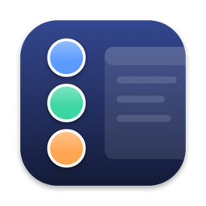

# Profile Bubbles

Small bubbles that always float at the edge of your Mac screen (left by default), one per
Google Chrome profile. Click a bubble (or press a hotkey) to jump to that profile's window.

Native macOS app: one Swift file, no dependencies, no network access.

## What it does

- One bubble per Chrome profile, with the profile's picture or its first letter.
- **Click** a bubble: brings that profile's open Chrome window to the front, tabs untouched.
  If the profile has no window, Chrome opens one.
- **Control+Option+1 … 9**: same as clicking bubble 1 … 9 (top to bottom).
- Hover shows the profile name and its hotkey.
- Choose where the bubbles sit: left edge, right edge, around the notch, bottom left or bottom right.
- Stays visible on every Space and over full-screen apps. No Dock icon.
- Right-click a bubble: settings, reload, edit the list, open at login, quit.

## Requirements

- macOS 13 or later, Google Chrome.
- Xcode Command Line Tools to build (`xcode-select --install`). Full Xcode is not needed.

## Build and run

```sh
./build.sh
open "build/Profile Bubbles.app"
```

There is no prebuilt download yet: the app is not notarized, so build it yourself.

## Settings

Right-click a bubble → **Settings…**

| Setting | Options |
|---|---|
| Position | Left edge, Right edge, Around the notch, Bottom left, Bottom right |
| Bubble size | Small, Medium, Large |
| Open at login | On / off |

- **Left / right edge:** a vertical column. Drag a bubble up or down to move the column.
- **Bottom left / right:** a horizontal row in the corner, above the Dock.
- **Around the notch:** the bubbles sit inside the menu bar, half on each side of the notch, and
  take the menu bar's height (the size setting is ignored). They can cover menu titles or menu bar
  icons that reach the notch. On a Mac without a notch they form a centred row under the menu bar.

## Permissions

| Permission | Why | Required? |
|---|---|---|
| Accessibility | Find and raise the Chrome window of a profile | Needed to focus an existing window. Without it every click opens a new window. |
| Full Disk Access | Read the profile list from Chrome's `Local State` file | Optional. Skip it by listing your profiles by hand (below). |

The app reads only the profile names, pictures and folder names. It never reads cookies,
history or passwords, and it sends nothing anywhere.

### Listing profiles by hand (no Full Disk Access)

Right-click a bubble → **Edit List**, or create
`~/Library/Application Support/ProfileBubbles/profiles.json`:

```json
[
  {"dir": "Default",   "name": "Personal", "color": "#1a73e8"},
  {"dir": "Profile 1", "name": "Work",     "color": "#e8710a", "image": "~/Pictures/work.png"}
]
```

- `dir` is the profile's folder name: open `chrome://version` in that profile and take the last
  part of **Profile Path**. Do not guess it: Chrome creates a new empty profile for an unknown name.
- `name` must match the profile's name in Chrome, because the app finds the window by that name.
- `color` and `image` are optional. When this file exists it replaces Chrome's own list, so it also
  lets you hide or reorder profiles.

### Keeping permissions across rebuilds

macOS ties a permission to the app's signature. An ad-hoc signature changes on every build, so the
grants are lost each time. To keep them, create a self-signed certificate once: **Keychain Access →
Certificate Assistant → Create a Certificate**, name `Local App Signing`, type **Code Signing**.
`build.sh` uses it automatically when it exists (set `SIGN_IDENTITY` to use another name).

## Known limits

- A profile window on another Space or in full screen is not found, so Chrome may open a new window.
- Works with Google Chrome only.
- Focusing relies on Chrome's window titles ending with the profile name, which Chrome does when
  more than one profile exists. A Chrome update can change this.

## Troubleshooting

Log file: `~/Library/Logs/ProfileBubbles.log`. Start with `--args --debug-menus` to log how the
app sees Chrome's menus. The log records profile names only, never page titles.

## License

MIT. Not affiliated with or endorsed by Google. Google Chrome is a trademark of Google LLC.
